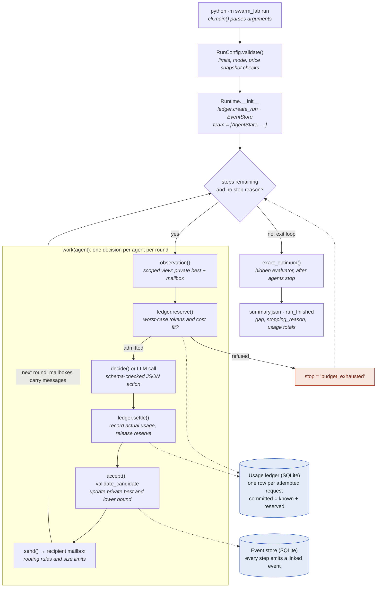

# How a swarm run works, from command to final state

This walkthrough follows the code that starts a run, creates the agents,
schedules their decisions, checks what they return, tracks token and dollar
spend, and decides when to stop. Code excerpts link to source pinned at
commit [`3ebdad3`](https://github.com/Entrasoft/agent-swarm/tree/3ebdad3), so
line numbers stay correct as the code changes.

The orchestrator is plain Python. `Runtime` in
[`runtime.py`](../swarm_lab/runtime.py) decides who acts, what each agent
sees, and when to stop. The model, when one is used, makes one structured
decision at a time and controls nothing else. Offline modes swap the model for
a seeded search policy, so the same control flow runs with no API key.

1. [Startup](#1-startup)
2. [Creating the agents](#2-creating-the-agents)
3. [The orchestration loop](#3-the-orchestration-loop)
4. [One agent decision](#4-one-agent-decision)
5. [Budget monitoring and stopping](#5-budget-monitoring-and-stopping)
6. [Reaching the final state](#6-reaching-the-final-state)
7. [From prompts to swarms](#7-from-prompts-to-swarms)

## Flow diagram



Solid arrows are control flow. A refused budget reservation sets the stop
flag; the round finishes its in-flight work before the loop exits. Dotted
lines to the two stores are writes.

## 1. Startup

`python -m swarm_lab run …` enters `cli.main()`, which turns the arguments
into a `RunConfig` and starts the async runtime.

[`swarm_lab/cli.py:283–294`](https://github.com/Entrasoft/agent-swarm/blob/3ebdad3/swarm_lab/cli.py#L283-L294)

```python
config=RunConfig(m=args.m,agents=args.agents,condition=args.condition,mode=args.mode,steps=args.steps,
    concurrency=args.concurrency, ..., token_limit=..., cost_limit=..., max_output=args.max_output, ...)
result=asyncio.run(Runtime(config,args.out).run())
```

`RunConfig.validate()` rejects unsafe settings before anything runs. Live mode
needs all of `--allow-live`, an exact model name, positive token and cost
limits, and a price snapshot whose `verified_on` date is today. Offline modes
must use the simulated fixture prices. Every limit is fixed before the first
decision.

## 2. Creating the agents

[`swarm_lab/runtime.py:139–181`](https://github.com/Entrasoft/agent-swarm/blob/3ebdad3/swarm_lab/runtime.py#L139-L181)

```python
config.validate()
self.provider = OpenAIProvider(...) if config.mode == 'live' else None   # auth before any files
self.ledger = Ledger(ledger_path or self.directory / 'usage.sqlite3')
self.ledger.create_run(self.run_id, config.token_limit, config.cost_limit, config.price, ...)  # budget registered
self.store = EventStore(self.directory, self.run_id)                                         # event log
self.team = [AgentState(f'agent-{i}',
                        'coordinator' if i == 0 and config.condition in {'fixed','adaptive'} else 'searcher',
                        random.Random(config.seed * 1009 + i)) for i in range(config.agents)]
self.semaphore = asyncio.Semaphore(config.concurrency)
```

> **An agent is a small record, not a process.** `AgentState` holds an ID, a
> role, a private random seed, the agent's own best answer (`private_best`), a
> mailbox and a call counter. Nothing runs persistently per agent. Each
> decision is a stateless call, and the runtime rebuilds the agent's context
> every time. Memory lives in your state, not in a conversation.

| Condition | Team | Communication |
| --- | --- | --- |
| `solo` | 1 searcher | None |
| `independent` | N searchers | None; outgoing messages are rejected |
| `fixed` | agent-0 coordinator, N−1 searchers | Star: searchers send only to the coordinator, which rotates its recipient |
| `adaptive` | Same as fixed | A heuristic, or the model in live mode, chooses recipient and timing |

## 3. The orchestration loop

`Runtime.run()` works in rounds. Each round gives every agent one decision,
waits for all of them, then checks whether to continue.

[`swarm_lab/runtime.py:478–494`](https://github.com/Entrasoft/agent-swarm/blob/3ebdad3/swarm_lab/runtime.py#L478-L494)

```python
step = 0
while step < self.config.steps and not self.stop:
    width = min(self.config.agents, self.config.steps-step)
    selected = self.team[:width]
    if self.config.allocation == 'exploratory':
        chosen = exploratory_priority(list(self.by_id), self.stats, step)
        selected = [self.by_id[chosen]]
    outcomes = await asyncio.gather(
        *(self.guarded_work(agent, step+i) for i,agent in enumerate(selected)),
        return_exceptions=True)
    for outcome in outcomes:
        if isinstance(outcome, BaseException):
            raise outcome
    step += len(selected)
self.stop = self.stop or 'step_limit'
```

- **`steps`** counts decisions across the whole team, not per agent. It is the
  main limit.
- **`self.stop`** is one shared flag. Any part of the run can set it to a
  reason string, and every loop and worker checks it.
- **The semaphore** caps how many provider calls are in flight. Live calls run
  in threads, so up to `concurrency` can overlap within a round. Offline
  decisions run one after another.
- **Exploratory allocation** picks a single agent per step using verified
  progress divided by estimated cost, with an exploration bonus
  ([`policies.py:131–162`](https://github.com/Entrasoft/agent-swarm/blob/3ebdad3/swarm_lab/policies.py#L131-L162)).

## 4. One agent decision

`work()`
([`runtime.py:326–449`](https://github.com/Entrasoft/agent-swarm/blob/3ebdad3/swarm_lab/runtime.py#L326-L449))
runs six stages per decision. They match the `work(agent)` box in the diagram.

### a. Build a limited view of the world

`observation()` gives the agent only what it may see. This JSON object is the
prompt, rebuilt for every decision.

[`swarm_lab/runtime.py:183–200`](https://github.com/Entrasoft/agent-swarm/blob/3ebdad3/swarm_lab/runtime.py#L183-L200)

```python
# Deliberately no global incumbent, oracle, aggregate artifact store, or other agent state.
result = dict(m=..., agent_id=..., role=..., round=agent.calls, private_best=list(agent.private_best),
              mailbox=mailbox, peers=[...], condition=..., task_id=task_id)
while len(json.dumps(result).encode()) > self.config.context_bytes and result['mailbox']:
    result['mailbox'].pop(0)       # bounded context: oldest messages dropped first
```

### b. Reserve budget before calling

The runtime asks the ledger to admit the call's worst-case cost. A refusal
ends the run. Details are in [section 5](#5-budget-monitoring-and-stopping).

### c. Get a decision

[`swarm_lab/runtime.py:366–396`](https://github.com/Entrasoft/agent-swarm/blob/3ebdad3/swarm_lab/runtime.py#L366-L396) (condensed)

```python
if self.config.mode == 'live':
    result = await asyncio.to_thread(correlated_call, observation, client_request_id)
elif self.config.mode == 'scripted':
    action = {'candidate':[1,2,4], ...}
else:
    action = decide(observation, agent.rng)        # seeded greedy search, no LLM
```

In live mode the request carries a fixed system prompt, the observation as
JSON, and a strict JSON schema
([`providers.py:24–40`](https://github.com/Entrasoft/agent-swarm/blob/3ebdad3/swarm_lab/providers.py#L24-L40)).
The model can only return this shape, with no tools and no free text:

```text
{'candidate': [ints], 'message': null | {type, recipient, content}, 'used_event_ids': [ints]}
```

The schema is the contract between the agent and the orchestrator.

### d. Settle usage and retry if needed

`ledger.settle()` records the reported usage, and a `usage` event logs running
totals. A failed attempt retries up to `max_retries` times, and each retry
needs its own reservation.

### e. Validate before anything changes

`accept()` is the trust boundary. A deterministic checker, not the model,
decides whether the answer is valid.

[`swarm_lab/runtime.py:276–294`](https://github.com/Entrasoft/agent-swarm/blob/3ebdad3/swarm_lab/runtime.py#L276-L294) (condensed)

```python
result = validate_candidate(self.config.m, candidate)   # deterministic checker
if result.valid:
    if len(candidate) > len(agent.private_best):
        agent.private_best = candidate                  # the agent's own memory
    if len(candidate) > self.lower_bound:
        self.best, self.lower_bound = candidate, len(candidate)   # experimenter's view only
```

The run keeps two views of progress. Each agent's `private_best` goes back
into its next prompt. The global `lower_bound` is visible only to the
experimenter, so agents learn the team's best answer only through messages.

### f. Route messages

`send()` enforces the routing rules and logs every rejection.

[`swarm_lab/runtime.py:210–219`](https://github.com/Entrasoft/agent-swarm/blob/3ebdad3/swarm_lab/runtime.py#L210-L219) (condensed)

```python
if condition in {'solo','independent'}:                        reason = 'condition forbids sharing'
elif type not in PROTOCOL or recipient not in self.by_id ...:  reason = 'invalid protocol or recipient'
elif condition == 'fixed' and role != 'coordinator' and recipient != 'agent-0':
                                                               reason = 'fixed routing requires coordinator'
elif size > message_bytes:                                     reason = 'message size limit'
elif len(recipient.mailbox) >= mailbox_limit:                  reason = 'mailbox full'
```

Messages containing an invalid candidate are blocked too. Accepted messages
land in the recipient's mailbox and appear in that agent's next observation.
Agents never talk directly; the runtime carries every message.

### What this looks like in the event log

The first two decisions of an offline `fixed` run with three agents and six
steps. Every event links to the events that caused it, which is what makes
`replay --verify` and the desktop viewer possible.

```text
 2  assignment          scheduler -> agent-0  task-0
 3  observation         agent-0               task-0
 4  usage               agent-0               task-0   reserve + settle
 5  candidate_submitted agent-0               task-0
 6  verification        verifier  -> agent-0  task-0
 7  message_sent        agent-0   -> agent-1  task-0   coordinator shares
 8  message_delivered   agent-0   -> agent-1
10  assignment          scheduler -> agent-1  task-1
11  message_read        agent-1               task-1   consumes mailbox
12  observation         agent-1               task-1
14  artifact_used       agent-1               task-1   built on agent-0's answer
 …
55  evaluation          evaluator
56  run_finished        runtime                        stopping_reason: solved, gap 0
```

## 5. Budget monitoring and stopping

The runtime checks the budget **before** every call, not after. A call runs
only if its worst case fits inside what is left.

[`swarm_lab/runtime.py:355–363`](https://github.com/Entrasoft/agent-swarm/blob/3ebdad3/swarm_lab/runtime.py#L355-L363)

```python
admitted = self.ledger.reserve(self.run_id, attempt_id, ..., estimate, self.config.max_output, self.config.model)
if not admitted:
    self.stop = 'budget_exhausted'
    self.store.emit('task_cancelled', ...)
    return
```

Inside `Ledger.reserve()`, a SQLite `BEGIN IMMEDIATE` transaction locks
writes, so two parallel agents cannot both pass the check against the same
remaining budget.

[`swarm_lab/ledger.py:344–365`](https://github.com/Entrasoft/agent-swarm/blob/3ebdad3/swarm_lab/ledger.py#L344-L365) (condensed)

```python
tokens = input_estimate + max_output                      # worst case: full output allowance
if (committed["committed_tokens"] + tokens > run["token_limit"] or
        committed_cost + reserved_cost > run["cost_limit"]):
    return False
# the same check runs against campaign-wide token, cost and call limits
```

The input estimate is deliberately high: it counts the request's bytes plus
1,024, which overstates tokens
([`providers.py:196–199`](https://github.com/Entrasoft/agent-swarm/blob/3ebdad3/swarm_lab/providers.py#L196-L199)).
Spend is tracked as committed totals:

[`swarm_lab/ledger.py:521–525`](https://github.com/Entrasoft/agent-swarm/blob/3ebdad3/swarm_lab/ledger.py#L521-L525)

```python
"committed_cost": _amount(known + reserved),
result["committed_tokens"] = tokens + result["reserved_tokens"]
```

When usage comes back, `settle()` releases the reservation and records the
real cost, using `Decimal` and a frozen price snapshot. If usage is missing,
for example after a timeout, the reservation **stays in place**, because the
call may still have been charged.

The totals are visible as the run goes. Every `usage` event carries
`committed_tokens`, `remaining_tokens`, `committed_cost` and `remaining_cost`,
and the ledger exports to JSON and CSV after each call. The six-step demo
ended at 1,008 committed tokens of 100,000 and USD 0.001482 of 1.00, both
simulated.

### Every way a run ends

| `stopping_reason` | Triggered by |
| --- | --- |
| `step_limit` | All decisions used. The normal end. |
| `solved` | Set after the loop, when the hidden evaluation closes the gap. |
| `budget_exhausted` | `reserve()` refused the next call. |
| `unresolved_usage` | In stop-on-failure runs (campaigns, feedback-v0.2), an attempt has unknown usage. |
| `provider_failure` | A failed provider attempt in stop-on-failure runs. |
| `protocol_failure` | An action that breaks the feedback-v0.2 protocol. |
| `invalid_candidate` | An invalid answer in stop-on-failure runs under the legacy protocol. |
| `worker_failure` | An exception inside any agent's work. |

> The stop is cooperative. Workers check the flag before starting and before
> each retry. A call already in flight finishes, because cancelling a Python
> task cannot take back spend on the provider side.

## 6. Reaching the final state

Once the agents stop, a separate exact solver that the agents never see
measures the result.

[`swarm_lab/runtime.py:496–502`](https://github.com/Entrasoft/agent-swarm/blob/3ebdad3/swarm_lab/runtime.py#L496-L502)

```python
# Hidden evaluation happens only after workers stop. No evaluator answer feeds their contexts.
oracle = await asyncio.to_thread(exact_optimum, self.config.m, self.config.oracle_timeout)
self.upper_bound = oracle.upper_bound
gap = self.upper_bound - self.lower_bound
if gap == 0 and self.stop == 'step_limit':
    self.stop = 'solved'
```

The run then writes `summary.json`, a `run_finished` event and the ledger
exports. The swarm does not stop early when it finds the best answer: agents
cannot know an answer is optimal, so `solved` is decided only afterwards.
During the run, only budget limits and failures end it early.

## 7. From prompts to swarms

| Step | What changes |
| --- | --- |
| Prompt to code | Each model call is a stateless function. A JSON observation goes in; a schema-checked JSON action comes out. |
| Code to agent | A loop owns the state and calls the model repeatedly, feeding each validated result back in. |
| Agent to swarm | Several loops share one scheduler and one budget, and talk only through mailboxes the runtime controls. |

The main lesson is that **the model proposes and deterministic code decides**.
The checker, routing rules, budget ledger and stop flag are all ordinary
Python, and the model has no say over them. On when a swarm is warranted: the
[live comparison](live-comparison-results.md) found no evidence that
coordination helped on this problem.

---

Line references are pinned to commit `3ebdad3`. The event log and budget
figures come from an offline algorithmic run with simulated prices and no
model calls. See also the [architecture notes](architecture.md).
